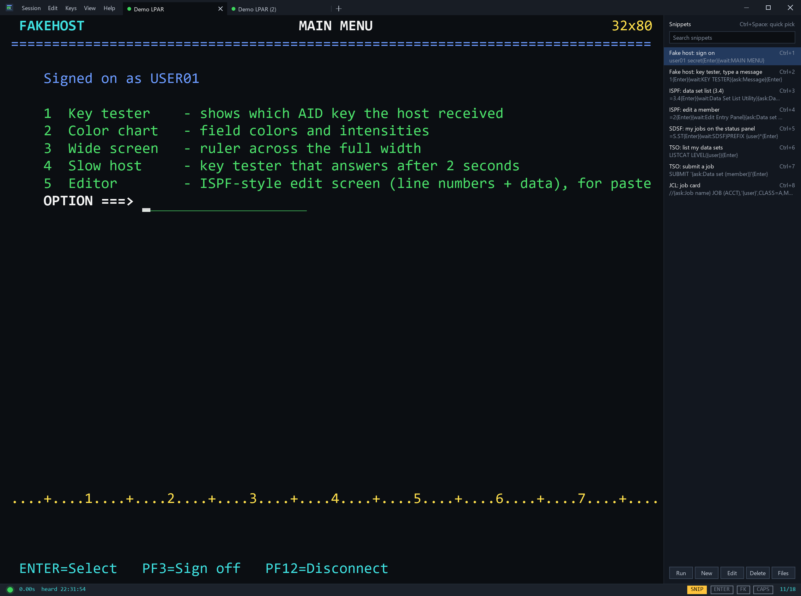
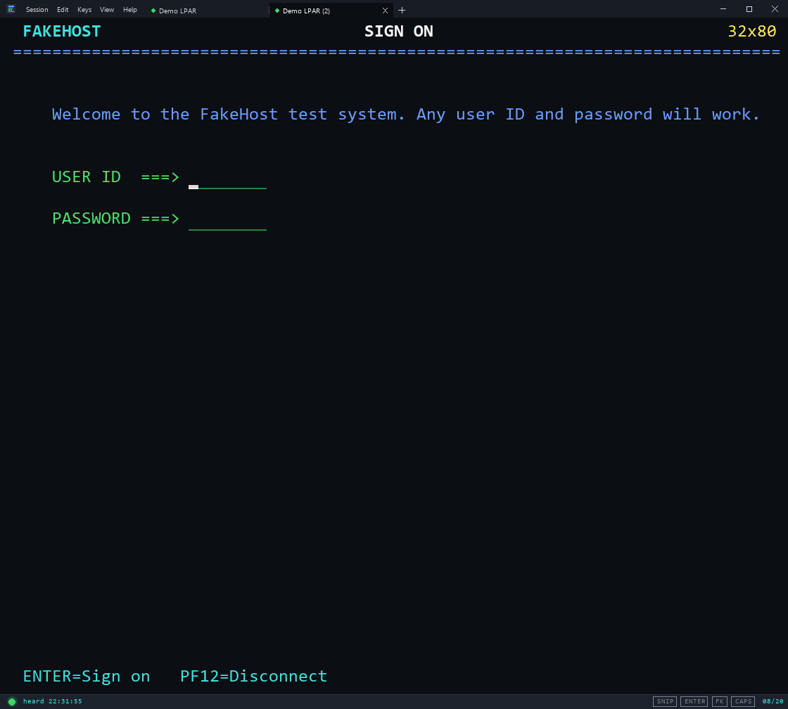

# ruby3270

A 3270 mainframe terminal for the desktop, written in Ruby. Old green screens, new Ruby.

- A desktop window, built on [libui](https://github.com/kojix2/LibUI) directly (one small gem, quick to start)
- A Ruby API for scripting 3270 screens
- A fake host for trying it out without a mainframe

The 3270 protocol itself is handled by **s3270** (`ws3270.exe` on Windows) from the
[x3270 suite](https://x3270.bgp.nu). ruby3270 drives it and draws the screen.



## Features

- Screen scales with the window: the font is measured and the largest size that fits is picked on every resize
- Quick to start and to draw: about 75 files load at startup (antivirus scanners check each one), and a
  full 62 x 160 screen redraws in about 5 ms
- VS Code style title bar (Windows): the menus sit inside the title bar, next to the icon, with the
  window buttons on the right (to use the normal Windows title bar instead, set `custom_title_bar: false`
  in the config file)
- **Session tabs**, like a browser: several sessions in one window, each tab with its own status light
  (green = connected, amber = connecting, grey = not connected). The tabs sit in the title bar next to the
  menus. Ctrl+T or the + button opens a tab, Ctrl+W or the tab's × closes it (so does a middle-click),
  Ctrl+Tab / Ctrl+Shift+Tab move between them, Ctrl+N opens a new window
  - **Drag a tab** along the strip to reorder it; drag it off the strip to give it a window of its own;
    drop it onto another window's tabs to join them there. The session stays connected the whole time
  - Right-click a tab for New Tab, Duplicate Tab, Rename Tab, Move Tab to New Window, Close Tab and Close
    Other Tabs (Duplicate and Rename are in the Session menu too). Double-click a tab to rename it right
    there: type, then Enter (Esc cancels; an empty name goes back to the session name)
  - A **new tab** lists your saved sessions, most recently used first: click one, or press 1-9. At the top, **Duplicate** (or D)
    opens another connection to the session in the tab you opened it from
  - Opening a session (Connections, a desktop shortcut) uses the current tab if it isn't
    connected, otherwise a new tab, so a live session is never replaced
  - **One running copy**: launching ruby3270 again (a desktop shortcut, say) opens that session as a tab in
    the window you have open, instead of a second program. Turn off with `single_instance: false`
- The window title (and taskbar) shows the current tab's session name, never the host address. Two tabs on the same session are numbered: `PROD`, `PROD (2)`
- Status bar pinned to the bottom of the window, with a status light: green = connected,
  amber = connecting, grey = disconnected. Click it to disconnect, or to reconnect to the last host.
  Hover over it for the host address and port, session, response time and when the host last sent
  anything. Next to it: the response time and the time the host was last heard from (`0.12s  heard 14:03:27`)
- **Multi-line paste** (Ctrl+V): each line goes in at the column the paste started in, one row down, so code
  pasted into ISPF EDIT lines up instead of landing in the line numbers. A line too long for its field is cut
  at the field's end, and the paste stops at the bottom of the screen (the status bar says so). Where there's
  no input field below (a form), the line goes in the next input field down. Pasting overwrites what's there:
  in ISPF, make room first with a line command such as `I5`
- **Undo** (Ctrl+Z or Edit > Undo): takes back the last paste, snippet, spelling fix or run of typing
  (up to 20 steps), putting back the fields' text and the cursor. It works until you press Enter, a PF
  key or anything else the host answers, because the host's new screen replaces what was there.
  Password fields are never touched
- F1-F12 = PF1-12, Shift+F1-F12 = PF13-24, Ctrl+F1-F3 = PA1-3, Right Ctrl = New line
  (full list under Help > Keyboard)
- **Keyboard mapping** (Keys > Keyboard Mapping...): double-click an action and press any key combination,
  including a modifier on its own such as Right Ctrl
- **Screen history** (Ctrl+H or View > Screen History...): the last 250 screens, saved each time you press
  Enter/PF/PA/Clear, in a separate window with a large preview and a strip of thumbnails. Arrow keys or the
  arrow buttons move through them. Drag on the preview to select text (Ctrl+A selects all), then Ctrl+C or
  Copy to copy it, or Paste to Session to type it into the live screen at the cursor
- **Display font** (View > Font...): pick from the monospaced fonts installed on the PC, with a preview in
  the chosen font; the size always follows the window
- **Connections** (Session > Connections...): saved hosts with port, TLS, LU name and screen size
  (24x80, 32x80, 43x80, 27x132, 62x160, or type any Rows and Columns), plus the path to the engine. **Duplicate** copies the
  connection on show as "Name (2)", "Name (3)"... for a variant of a session
- **Edit Session** (Session > Edit Session...): the same dialog, open on the current tab's session, to change
  and save it. Connect reconnects the tab with the changes; a typed `host:port` session can be saved this way
- **TLS certificates**: by default the host's certificate isn't checked, so self-signed mainframe
  certificates just work. Tick "Verify the host's certificate" on a connection to check it. Unchecked, the
  connection is encrypted but can't tell an impostor from the real host, so turn it on for hosts
  reached over networks you don't trust
- **Startup script** (per connection): a file run in the background each time that connection comes up,
  for example to sign on. Ruby, PowerShell, batch or Python; it's told which session to drive and that
  ruby3270 started it. See [Startup scripts](#startup-scripts)
- **Desktop shortcuts** (Windows): pressing Save in Session > Connections puts a shortcut with the app icon
  on your desktop, named after the session. Double-click it to open the emulator already connecting to that
  session. Renaming or deleting the session removes its old shortcut. Turn off with `desktop_shortcuts: false`
- **Copy a region**: drag across the screen to select a block, then Ctrl+C. With nothing selected,
  Ctrl+C copies the whole screen. A plain click moves the cursor. Right-click while something is
  selected copies it, clears the selection and moves the cursor to the pointer
- **Type-ahead**: keys typed while the host is still answering (status bar shows X SYSTEM and
  TYPE-AHEAD n) are queued and sent in order once it answers
- **Esc unlocks**: while the keyboard is locked (X SYSTEM, or X -f after typing where you can't), Esc is
  Reset: it unlocks at once, drops any queued keys, and if the cursor is somewhere you can't type it
  moves to the next input field. While a bad entry has the keyboard locked (X -f) the screen background
  turns dark red. On an unlocked screen Esc is Clear. Ctrl+R is always Reset
- **Spell check** (Windows): misspelled words in long input fields (20+ characters, `spell_min_field`)
  get a red wavy underline. ALL-CAPS words are checked too. Right-click one for suggestions, Ignore, or
  Add to the Windows dictionary; Ctrl+; jumps to the next one. Codes like SYS1.PROCLIB or IEF142I and
  hidden fields are skipped. View > Spell Check turns it off; View > Spell Check Language picks the
  language. Uses the spell checker built into Windows, so there's nothing to install. Common mainframe
  terms (JCL, MSGCLASS, SYSOUT, IDCAMS, CICS...) are never flagged. Ignored words go in your own text file,
  `~/.ruby3270-spelling.txt` (View > Edit My Spelling Words opens it), and a team can add its own word list:
  see [Spelling word lists](#spelling-word-lists)
- **Find** (Ctrl+F or Edit > Find...): highlights matches on the screen as you type; Next / Previous move
  the cursor to them. "Search Screen History" lists matching lines in saved screens
- **Response time**: how long the host took to answer the last Enter/PF/PA key, in the status bar,
  followed by the time the host last sent data
- **Crosshair** (Ctrl+Shift+X or View > Crosshair): faint bands along the cursor's row and column
- **Numeric fields** accept only 0-9 . - (Keys > Numeric Fields: Digits Only)
- **CAPS button** in the status bar (or Edit > Caps Lock): types letters in upper case in this app only.
  The keyboard's Caps Lock is untouched, so other programs aren't affected
- **ENTER button** in the status bar (or Keys > Auto Enter): presses Enter again 2 seconds after each answer
  from the host, over and over, to watch a job finish. Click it again to stop; it also stops by itself when
  the connection ends or the keyboard locks with an error. Change the pause with `auto_enter_seconds` in the
  config file
- **Tooltips**: rest the pointer on the connection light or the SNIP, ENTER, FK or CAPS buttons to see what they do
- **Snippets** (SNIP button, View > Snippets Sidebar, or Ctrl+Space): text and key sequences you type with a
  double-click, a hotkey or a few letters. See [Snippets](#snippets)
- **Script folders** (Snippets sidebar > Files > Add Script Folder...): the scripts in a folder (.rb, .ps1,
  .bat, .py...) show in the snippet list with the name and description from their top comments, and
  double-clicking one runs it in the background on the session. See [Script folders](#script-folders)
- **Quick picker finds settings too** (Ctrl+Space): type `caps`, `auto enter`, `underline`, `key bar`...
  and Enter switches that option on or off, just like its menu item
- **Export / Import Settings** (Session menu): your sessions, snippets and options in one file, to move to
  another PC or give to a colleague. A team's `welcome.yml` sets up a coworker's first launch. See [Config](#config)
- **Quick keys**: the screen updates as soon as the host answers (about 6 ms for a cursor key against a local
  host), and a new tab opens at once while its engine starts in the background
- App icon (`assets/tn3270.ico`, drawn by `script/make_icon.rb`)
- 3270 colors, intensified fields, hidden (password) fields, reverse video and underscore
- Optional underlines on input fields
- **Key bar** (FK button in the status bar, or View > Key Bar): PF1-PF24 plus Reset, Clear, Attn, New Line
  and SysReq as buttons. Clicking one gives the keyboard straight back to the screen
- **Window shape follows the screen** (Windows, View > Lock Window Shape to the Screen, on by default):
  dragging an edge keeps the window the shape of the mainframe screen, so the text fills it with no empty
  band. The window also reshapes when the screen size changes (another host, or the key bar shown)
- Status line with keyboard lock (X SYSTEM), insert mode and cursor position (`05/12`; it has as many
  digits as the screen size needs, and hovering over it shows the size, e.g. 24 x 80)
- Menu items show their keyboard shortcut on the right (`Copy    Ctrl+C`), and follow Keys > Keyboard Mapping
- Ruby API (`Tn3270::Session`) the window is built on, usable from your own scripts

## Requirements

| What | Version | Why |
|---|---|---|
| Ruby | 3.2 or newer (tested on 3.3 and 4.0) | Runs the app |
| x3270 engine: `ws3270.exe` (Windows) or `s3270` (Linux, macOS) | 4.x | Speaks the 3270 protocol to the host |
| Gems from the Gemfile: `libui`, plus `win32ole` on Windows | installed by `bundle install` | The window, and desktop shortcuts |
| A 3270 host | any | Something to connect to. The built-in fake host works for trying it out |

No C compiler is needed: the `libui` gem ships the libui library ready-made and has no other gems behind
it. The scripting API and the tests use only Ruby's standard library plus the engine, so they work without
the gems.

Runs on Windows, Linux and macOS. Windows gets a few extras: the VS Code style title bar, the window
icon, desktop shortcuts and Right Ctrl as a key of its own.

## Setup

**Windows**

1. Install Ruby from [rubyinstaller.org](https://rubyinstaller.org). The DevKit isn't needed.
2. Install wc3270 from [x3270.bgp.nu](https://x3270.bgp.nu/download.html). ruby3270 finds `ws3270.exe` in
   the default install folder (`C:\Program Files\wc3270`) by itself. If you installed it elsewhere,
   add that folder to PATH or set `engine:` in the config file (below).
3. In this folder, run `bundle install`.

**Linux:** install Ruby and the `s3270` package (for example `sudo apt install ruby s3270`), then run `bundle install`.

**macOS:** `brew install ruby x3270`, then run `bundle install`.

## Run

```
ruby bin/fake_host              # terminal 1: pretend mainframe on port 3270
ruby bin/tn3270 127.0.0.1:3270  # terminal 2: the emulator
```

`ruby bin/tn3270 --session "Work mainframe"` opens a saved session by name (desktop shortcuts use this).
If ruby3270 is already running, the session opens as a tab in it and the new launch exits.

Sign on with any user ID. Option 1 is a key tester that shows which PF/PA key the
host received, option 2 is a color chart, option 3 shows a ruler across all 160 columns, option 4 is a
key tester that answers slowly (for type-ahead), and option 5 is an **ISPF-style editor**: line numbers in
columns 1-6 and 72 columns of data, line commands `I` (insert) and `D` (delete), PF7/PF8 to scroll, PF3 to
save. It's there to try multi-line paste and editor-style screens without a mainframe.

## Scripting

Full guide, with a reference of every call and recipes for common jobs: [docs/API.md](docs/API.md).

A script can start its own session, or **attach to the one open in the window** (on by default, port
3271 for the first session) so you watch it work and the session stays open afterwards. Any program
on this computer can then drive the session; untick Session > Allow Scripts to Attach to stop that.

```ruby
require "tn3270"

Tn3270::Session.open("myhost:3270") do |s|       # or: Tn3270::Session.attach do |s|
  s.logon("USER01", ENV["PW"], wait_for: "READY") # fill USER ID + PASSWORD, Enter, wait
  s.submit("OPTION", "3.4", wait_for: "DSLIST")   # type a command, Enter, wait for the reply
  puts s.line(0)                                  # read a row
  puts s.value("COMMAND")                         # read an input field
  s.press_and_wait(:pf8)                          # any key, wait for the screen to change
  s.wait_for_text_gone("PLEASE WAIT")
  s.pf(3)
end
```

Main calls: `fill`, `fill_form`, `type`, `enter`, `pf(n)`, `pa(n)`, `press(key)`, `submit`, `logon`,
`wait_for_text`, `wait_for_text_gone`, `wait_for_change`, `wait_until { |screen| }`, `press_and_wait`,
`text`, `line`, `lines`, `value`, `find`, `on_screen?`, `cursor`, `screen`, `page_until`, `save_screen`
and `raw("AnyS3270Action()")`.

Examples: [examples/common_calls.rb](examples/common_calls.rb) (a tour of the calls, against the fake
host), [examples/attach_to_session.rb](examples/attach_to_session.rb) (drives the window's session),
[examples/login_script.rb](examples/login_script.rb).

## Snippets



A snippet is text to type, with keys and placeholders in braces, so one snippet can walk through
several screens:

```
=3.4{Enter}{wait:Data Set List Utility}
{ask:Data set level}{Enter}
```

- **Sidebar** (the SNIP button, View > Snippets Sidebar or Ctrl+Shift+S): the window grows wider to make
  room, so the screen keeps its size. Search, double-click to type one, **New / Edit / Delete**, and **Files** to choose where snippets come from. Rest the pointer on a
  snippet to see its text.
- **Quick pick** (Ctrl+Space, or Edit > Snippets: Quick Pick): type a few letters, Enter types it.
  **Ctrl+N** (or the New button) makes a new snippet named after what you typed; **Ctrl+E** (or Edit) edits
  the chosen one. A snippet from a shared file you can't change opens as your own copy.
  It finds settings too: type `caps`, `auto enter`, `underline`, `crosshair`, `key bar`, `spell`... and
  Enter switches that setting on or off (the row shows ON / OFF), just like its menu item.
- **Hotkeys**: Ctrl+1 to Ctrl+9 type the first nine snippets in the sidebar list (change them in
  Keys > Keyboard Mapping).
- **From the screen**: select text, then Edit > New Snippet from Selection.

| In a snippet | Does |
|---|---|
| `{Enter}` `{PF1}`-`{PF24}` `{PA1}`-`{PA3}` `{Clear}` `{Attn}` `{SysReq}` | Presses the key and waits for the host to answer |
| `{Tab}` `{BackTab}` `{Home}` `{NewLine}` `{Reset}` `{EraseEOF}` `{EraseInput}` `{Up}` `{Down}`... | Presses the key |
| `{wait:READY}` | Waits until that text is on the screen (up to `snippet_wait_seconds`, 30 by default) |
| `{ask:Job name}` | Asks for a value when the snippet runs (each question once) |
| `{date}` `{date:%y%m%d}` `{time}` `{time:%H%M}` `{user}` `{clipboard}` | Fills in today's date, the time, your Windows user name, or the clipboard |
| a new line | Moves to the next input field, unless the line ended with a key |
| `{{` | A literal `{` |

**Your snippets and shared ones.** Your own snippets are in `~/.ruby3270-snippets.yml`. Under
**Files** you can add shared files or whole folders of `.yml` files, for example a team file on a
network drive, or create a new shared file. Snippets from files you can't write to are read-only.
Each file is a plain YAML list, easy to edit by hand or keep in git:

```yaml
- name: "SDSF: my jobs"
  text: "=S.ST{Enter}{wait:SDSF}PREFIX {user}*{Enter}"
```

[examples/snippets.yml](examples/snippets.yml) has examples for ISPF, TSO, SDSF and JCL, plus a few for
the fake host.

### Script folders

For anything a snippet can't do (loops, decisions, reading files), keep scripts in a folder and add it
under **Files > Add Script Folder** (setting `script_folders`). Each script in it (`.rb`, `.ps1`, `.bat`,
`.cmd`, `.py`, `.vbs`, `.js`) shows in the sidebar and the quick pick next to your snippets, and
picking one runs it on the current session, in the background, exactly like a
[startup script](#startup-scripts): the same environment variables, `status` lines in the status bar,
and it stops when the tab disconnects or closes. Edit opens the file in Notepad. Scripts are found
again when the folder changes.

The comments at the top of the script give the name and description:

```ruby
# Name: Release held jobs
# Releases every held job for your user ID in SDSF.
# Takes about 10 seconds; asks nothing.

wait_for_text("READY")
...
```

- `Name:` is optional; without it the file name is used (`release_held_jobs.rb` becomes "Release held jobs")
- the other comment lines are the description: the first one shows under the name in the list, all of
  them when you rest the pointer on it, and the quick pick searches them
- comments are `#` (Ruby, PowerShell, Python), `REM` or `::` (batch), `'` (VBScript) or `//` (JScript).
  A `#!` line, `# frozen_string_literal`, `# encoding` or `@echo off` before them is skipped

A script folder opens the script port by itself (even with Session > Allow Scripts to Attach off), from
the next connect.

## Startup scripts

A connection can run a script each time it comes up: pick it under Session > Connections > Startup
script. It runs in its own process, attached to that tab's session, so you see every step and the window
stays usable while it works (anything you type goes to the same session). A script may run as long as it likes,
for example to watch the session. Closing the tab, disconnecting or reconnecting stops it, together with
anything it started, and so does ruby3270 ending in any way, even a crash (on Windows each script and engine
sits in a job object that Windows closes with the app), so nothing is left running. Ruby scripts run with
`rubyw.exe`, so no console window opens. In a Ruby script the session methods can be called
directly ([examples/startup_script.rb](examples/startup_script.rb)):

```ruby
wait_for_text("USER ID")
fill("USER ID", "USER01")
fill("PASSWORD", ENV["TSO_PW"])   # keep passwords out of the file
enter
wait_for_text("READY")
status "Signed on to #{connection['name']}"   # shown in the status bar
```

If the script fails, the status bar shows the error and its line number. Each line a script prints shows
in the status bar too.

Other kinds of file work as well: `.ps1`, `.bat`/`.cmd`, `.py`, `.vbs`/`.js`, or any program. Every script
gets environment variables saying who started it and which session to drive, so one script shared by
several emulators can tell them apart:

| Variable | Value |
| --- | --- |
| `TN3270_EMULATOR` | `ruby3270` |
| `RUBY3270_VERSION` | the app's version |
| `TN3270_SESSION` | the session's name |
| `TN3270_HOST`, `TN3270_HOST_PORT`, `TN3270_LU`, `TN3270_TLS` (`1`/`0`), `TN3270_ROWS`, `TN3270_COLS` | the host it's connected to |
| `TN3270_SCRIPT_HOST`, `TN3270_SCRIPT_PORT` | where to attach: `127.0.0.1` and this tab's own port |
| `RUBY3270_LIB` | the app's `lib` folder, for `require "tn3270"` |
| `RUBY3270_CONNECTION` | the saved connection as JSON |

A script in another language drives the session by sending
[s3270 actions](https://x3270.miraheze.org/wiki/S3270_actions) to that port. A tab with a startup script
always opens its port, even with Session > Allow Scripts to Attach off.

## Config

Saved in `~/.ruby3270.yml` (`%USERPROFILE%` on Windows). Only the keys you change are needed:

```yaml
engine: 'C:\Program Files\wc3270\ws3270.exe'
font: Consolas
history_size: 250         # screens kept in the screen history
desktop_shortcuts: true   # Save in Connections also makes a desktop shortcut
snippet_files:            # shared snippet files or folders (yours: ~/.ruby3270-snippets.yml)
- '\\server\team\3270-snippets.yml'
script_folders:           # folders of scripts listed with the snippets (see Script folders)
- 'C:\mainframe\scripts'
lock_ratio: true          # keep the window the shape of the screen while resizing
single_instance: true     # launching again opens a tab in the running copy
keys:                     # overrides of the default key bindings ("" unbinds)
  Ctrl+Q: reset
  Escape: ""
connections:
- name: Work mainframe
  host: mainframe.example.edu
  port: 23
  tls: true
  verify_cert: false      # true: check the host's TLS certificate
  lu: ""
  rows: 27
  cols: 132
  script: 'C:\scripts\logon.rb'   # startup script ("" = none)
```

**Moving settings to another PC or a colleague:** Session > Export Settings saves your sessions, your own
snippets and the options you've changed into one `.yml` file. Session > Import Settings reads one back:
sessions and snippets with the same name are replaced, your others are kept, and the file's options replace
yours. Recently used sessions and the engine path stay on the computer they're from.

**Handing ruby3270 out to a team (`welcome.yml`):** set up one PC the way you want it, use Export Settings,
and name the file `welcome.yml`. Someone's first launch (no settings yet) imports it: the team's sessions
(instead of the built-in demo one), snippets and options. After that their own settings take over; it's
never imported again, so later changes they make are safe. ruby3270 looks for it in this order:

1. the file the `RUBY3270_WELCOME` environment variable names (e.g. `\\server\team\welcome.yml`, set by IT)
2. `C:\ProgramData\ruby3270\welcome.yml` (shared by everyone on the PC)
3. `welcome.yml` in the program folder

Use 1 or 2 so updating the program (a new zip, a `git pull`) can't remove it. The program never ships its
own `welcome.yml` (it's in `.gitignore`), so an update won't replace yours even in the program folder.

The menus write all of these for you; you rarely need to edit the file. A plain `ruby bin/tn3270 host:port`
uses `rows`/`cols` (default 62 x 160).

### Spelling word lists

Words spell check never flags come from these plain text files:

1. `lib/tn3270/gui/mainframe_words.txt`: comes with the program (JCL keywords, utilities, products) and is
   refreshed by updates. Don't edit it; use one of the files below
2. your own list, `~/.ruby3270-spelling.txt`: right-click > Ignore adds to it, and View > Edit My Spelling
   Words opens it in Notepad. To share it, send the file, or put it on a shared drive and list it in
   `spell_word_files`. `personal_spelling` (default `nil`) keeps it somewhere else
3. `spelling.txt` in `C:\ProgramData\ruby3270\` or the program folder: your company's terms, shipped with
   your installs. Like `welcome.yml`, the program never ships one, so updates leave it alone
4. any files in `spell_word_files` (default `[]`), e.g. `['\\server\team\spelling.txt']`, which a
   `welcome.yml` can set for everyone

One or more words per line, any case; lines starting with `#` are comments. A saved change to any of
the files takes effect within a couple of seconds, with no restart. Nothing in them is copied into
anyone's settings, so editing a shared file reaches everyone. Export Settings includes your own words,
and Import Settings adds them to the importer's file. Older versions kept ignored words in the
settings (`spell_ignore`); they move to your file the first time spell check runs.

## Tests

```
ruby -Ilib test/session_test.rb      # Ruby API against the fake host
ruby -Ilib test/gui_logic_test.rb    # key mapping and the GUI's background worker
ruby -Ilib test/tabs_test.rb         # tab strip, tab names and numbers, the single-instance handoff, picker settings
ruby -Ilib test/settings_transfer_test.rb  # Export / Import Settings and welcome.yml
ruby -Ilib test/spelling_test.rb     # which words spell check looks at
```

These need s3270; `tabs_test.rb` also needs the `libui` gem.

**README images** (`docs/images`) are recorded from inside the app against the fake host, so nothing is
typed into your desktop: see the comments at the top of `script/readme_media/record.rb`.

## Things to know

- **Screen size and the real host.** 160 x 62 is not a standard 3270 model. The emulator offers it
  as a dynamic size, and the host's logmode has to accept that. If the host only allows a fixed
  model, pick 27 x 132 (Model 5) or 24 x 80 for that connection in Session > Connections.
- **Keyboard layout.** libui reports keys unshifted, so shifted characters use a US layout table
  (`lib/tn3270/gui/keymap.rb`).

## Testing against a real MVS

Hercules with MVS 3.8j TK5 runs a free mainframe OS locally (prince-webdesign.nl/tk5).
Start it, then connect to `127.0.0.1:3270`.

## License

MIT. See [LICENSE](LICENSE). The x3270 suite (s3270 / ws3270.exe) is a separate project with its own license
and isn't included here.
